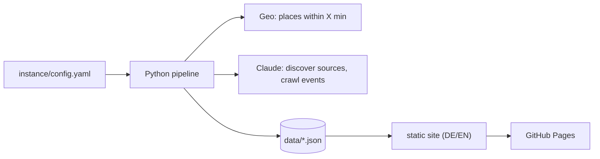

# Let's Gau

**Let's Gau** is an open-source event calendar. An AI collects all publicly
listed events within a configurable drive time around a center point (default:
30 minutes around Schongau, Bavaria) and publishes them as a static,
mobile-first website with one page per day for the next three weeks.

It runs without a server: GitHub Actions starts a Python pipeline, Claude
searches the web, results are stored as JSON and rendered to static HTML on
GitHub Pages. The site is equally usable by people on their phones, by search
engines and by AI assistants.

> **Status:** Phase 2 (event crawl). The geo stage computes the places within
> the drive time, the event crawl collects events with Claude into
> `data/events.json`; the website is not implemented yet.
> See [docs/CONCEPT.md](docs/CONCEPT.md) (German) for the full specification and
> the phase plan, and [docs/ISSUES.md](docs/ISSUES.md) for the task list.

<!-- Screenshot will be added in Phase 4. -->

## How it works



More detail in [docs/ARCHITECTURE.md](docs/ARCHITECTURE.md).

## Set up your own region

The full step-by-step guide is completed in Phase 8. The intended flow is:

1. **Fork** this repository.
2. **Secrets:** add `CLAUDE_CODE_OAUTH_TOKEN` (or `ANTHROPIC_API_KEY` with
   `ai.auth: api_key`) and `ORS_API_KEY` (free key from
   [account.heigit.org](https://account.heigit.org)) under *Settings → Secrets and
   variables → Actions*.
3. **Configure:** run `letsgau init` (or edit `instance/config.yaml`) with your
   center, drive time, name, domain, contact and GitHub owner.
4. **Enable GitHub Pages** with source *GitHub Actions*.
5. **Start the first run** via *Actions → Run → Run workflow*.

## Local development

Requires Python 3.12+.

```bash
python -m venv .venv
```

```bash
source .venv/bin/activate
```

```bash
pip install -e '.[dev]'
```

```bash
python -m letsgau --help
```

```bash
python -m letsgau check
```

```bash
ruff check . && ruff format --check . && pytest
```

Compute the places within the drive time (needs `ORS_API_KEY` in `.env`):

```bash
python -m letsgau run --job geo --dry-run
```

Crawl events for the three nearest places without writing anything (needs
`data/places.json` and `CLAUDE_CODE_OAUTH_TOKEN` or, with `ai.auth: api_key`,
`ANTHROPIC_API_KEY`):

```bash
python -m letsgau run --job events --dry-run --limit-places 3
```

## Repository layout

| Path | Purpose |
| --- | --- |
| `instance/` | the Schongau instance: `config.yaml`, `sources/`, `content/` |
| `examples/instance/` | templates for `letsgau init` |
| `src/letsgau/` | pipeline code |
| `prompts/` | AI prompts (versioned, editable without code changes) |
| `templates/`, `static/`, `i18n/` | website templates, CSS/JS, UI strings |
| `docs/` | architecture, data model, configuration, operations, ADRs |
| `tests/` | tests with recorded AI responses, no live AI calls |

Generated data (`data/`, `geo/`) lives on the bot-only `data` branch, the
generated website (`site/`) is never committed.

## License

[MIT](LICENSE)
