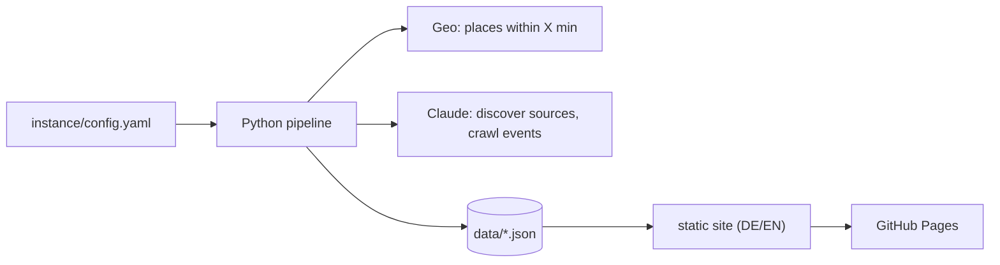

# Let's Gau

**Let's Gau** is an open-source event calendar. An AI collects all publicly
listed events in a configurable list of municipalities (default: Schongau and
Altenstadt, Bavaria) and publishes them as a static,
mobile-first website with one page per day for the next three weeks.

It runs without a server: GitHub Actions starts a Python pipeline, Claude
searches the web, results are stored as JSON and rendered to static HTML on
GitHub Pages. The site is equally usable by people on their phones, by search
engines and by AI assistants.

> **Status:** all phases of version 1 are implemented (geo, event crawl, merge,
> website, AI readability, scheduler and workflow, discovery, content pages);
> see [docs/ISSUES.md](docs/ISSUES.md).
> See [docs/CONCEPT.md](docs/CONCEPT.md) (German) for the full specification and
> the phase plan, and [docs/ISSUES.md](docs/ISSUES.md) for the task list.

<!-- Screenshot will be added in Phase 4. -->

## How it works



More detail in [docs/ARCHITECTURE.md](docs/ARCHITECTURE.md).

## Set up your own region

1. **Fork** this repository on GitHub (only `main` is copied; the original
   region's data stays on its `data` branch).
2. **Configure** your region on your computer (Python 3.12+):

   ```bash
   git clone https://github.com/<you>/letsgau && cd letsgau
   ```

   ```bash
   pip install -e .
   ```

   ```bash
   python -m letsgau init
   ```

   `init` asks for the region label, the municipalities (name and/or postcode,
   e.g. `Murnau am Staffelsee 82418, Seehausen`), site name, public URL, contact email and your GitHub user name, and replaces
   `instance/` with fresh files. Then fill the `[TODO]` markers in
   `instance/content/` (about text, imprint) and check everything:

   ```bash
   python -m letsgau check
   ```

   Commit and push `instance/`.
3. **Secrets:** under *Settings → Secrets and variables → Actions* add
   `CLAUDE_CODE_OAUTH_TOKEN` (create it with `claude setup-token`; needs a
   Claude subscription). Without a subscription set `ai.auth: api_key` and add
   `ANTHROPIC_API_KEY` instead; the workflow then also installs the Anthropic
   SDK (`pip install -e '.[api]'`, needed only in that mode).
4. **Enable GitHub Pages:** *Settings → Pages → Source: GitHub Actions*.
5. **Start the first run:** *Actions → Run → Run workflow*, job `all`. It
   computes the places, discovers sources, crawls the events and publishes the
   site. From then on the workflow runs every morning and does only what is due.

### Start a job by hand

*Actions → Run → Run workflow* lets you pick `auto`, `geo`, `discovery`,
`events`, `build` or `all` (also from the GitHub mobile app). Details, costs and
debugging: [docs/OPERATIONS.md](docs/OPERATIONS.md).

### Use your own domain

1. Set `site.base_url` in `instance/config.yaml` to your domain, e.g.
   `https://events.example.org`. The build then writes `site/CNAME`
   automatically (not for `*.github.io` addresses).
2. At your DNS provider create a `CNAME` record for `events.example.org`
   pointing to `<you>.github.io` (for an apex domain like `example.org`, use
   the GitHub Pages `A`/`AAAA` records instead).
3. In *Settings → Pages* enter the domain under *Custom domain* and enable
   *Enforce HTTPS* once the certificate is ready.

## Local development

Requires Python 3.12+.

```bash
python -m venv .venv
```

```bash
source .venv/bin/activate
```

```bash
pip install -e '.[dev]'
```

```bash
python -m letsgau --help
```

```bash
python -m letsgau check
```

```bash
ruff check . && ruff format --check . && pytest
```

Compute the places of the configured municipalities (OpenStreetMap, no key needed):

```bash
python -m letsgau run --job geo --dry-run
```

Crawl events for the three nearest municipalities without writing anything (needs
`data/places.json` and `CLAUDE_CODE_OAUTH_TOKEN` or, with `ai.auth: api_key`,
`ANTHROPIC_API_KEY`):

```bash
python -m letsgau run --job events --dry-run --limit-places 3
```

Build the website from `data/` and look at it:

```bash
python -m letsgau run --job build
```

```bash
python -m http.server --directory site
```

## Repository layout

| Path | Purpose |
| --- | --- |
| `instance/` | the Schongau instance: `config.yaml`, `sources/`, `content/` |
| `examples/instance/` | templates for `letsgau init` |
| `src/letsgau/` | pipeline code |
| `prompts/` | AI prompts (versioned, editable without code changes) |
| `templates/`, `static/`, `i18n/` | website templates, CSS/JS, UI strings |
| `docs/` | architecture, data model, configuration, operations, ADRs |
| `tests/` | tests with recorded AI responses, no live AI calls |

Generated data (`data/`, `geo/`) lives on the bot-only `data` branch, the
generated website (`site/`) is never committed.

## License

[MIT](LICENSE)
