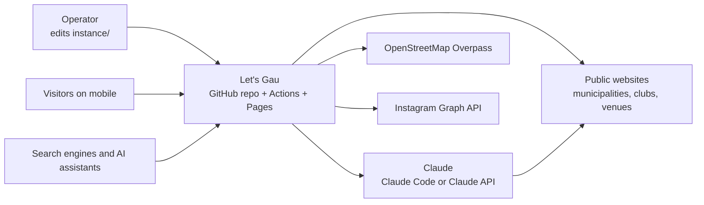
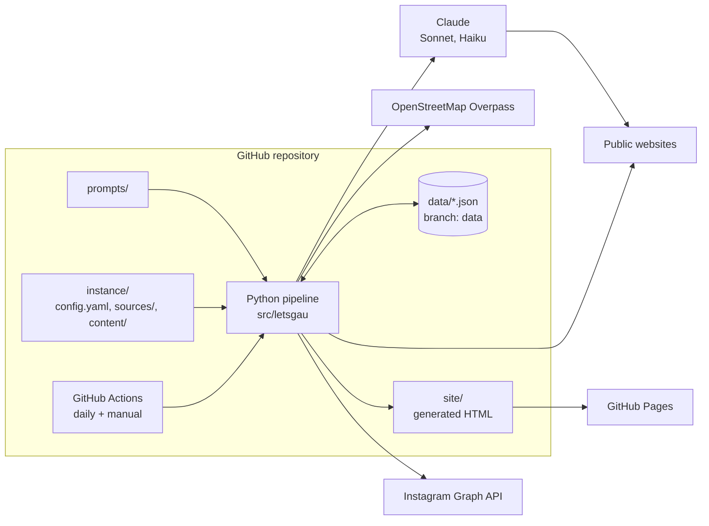
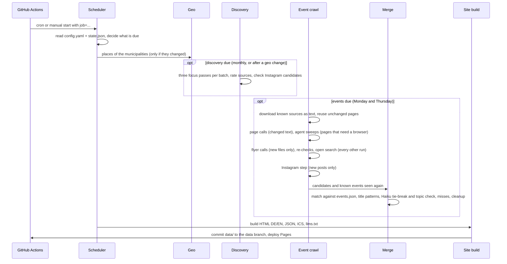
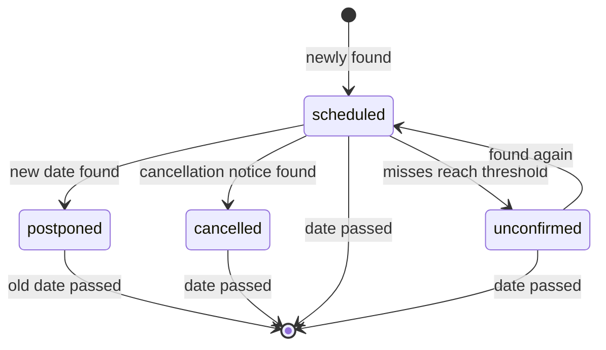

# Architecture

Everything lives in one GitHub repository. A workflow started daily runs a
Python pipeline that lets Claude read and search the web, stores the results as
JSON on the `data` branch and builds static HTML for GitHub Pages.

The authoritative specification is [CONCEPT.md](CONCEPT.md) (German). Details
of every stage are in [OPERATIONS.md](OPERATIONS.md), the files in
[DATA_MODEL.md](DATA_MODEL.md).

## Context (C4 level 1)

The pipeline downloads source pages, flyers and Instagram posts itself; Claude
reads them, and searches and fetches the web only where that is not enough
(discovery, the open search, pages that need a browser).

## Containers (C4 level 2)

## Modules

| Module | Responsibility |
| --- | --- |
| `cli` | command-line entry point (`letsgau check`, `run`, `sources`, `init`) |
| `config` | load and validate `instance/config.yaml` (file, line and field in errors) |
| `scheduler` | decide which jobs are due, run them in order, job summary |
| `geo` | places of the configured municipalities (Overpass) → `places.json` |
| `discovery` | find and rate sources per municipality (focus passes) → `sources.json`, `suggested.md` |
| `crawl` | event crawl per batch: plan the calls, validate answers, hand over to the merge |
| `pages` | source pages as text with a SHA-256 cache (`pages.json`): unchanged pages cost no AI call |
| `flyers` | download posters and PDFs of the flyer pages; the crawl's flyer calls with a cache (`flyers.json`) |
| `instagram` | Graph API (Business Discovery), candidate account check, the crawl's Instagram step (`instagram.json`) |
| `merge` | duplicates, AI tie-break and topic check, title patterns, status lifecycle, cleanup → `events.json` |
| `ai_runner` | Claude Code headless (subscription) or Claude API (`api_key`), JSON-schema answers, usage |
| `models` | Pydantic models of the `data/*.json` files |
| `build`, `feeds` | HTML DE/EN, JSON-LD, JSON, ICS, `llms.txt`, sitemap, robots |
| `init` | set up a fresh instance from `examples/instance/` |
| `util` | shared helpers: paths, URLs, prompt templates, JSON files, logging |

## Sequence of a run

## Event status lifecycle

A cancelled event stays visible until its date. A postponement creates a new
event on the new date; `postponed_to` on the old event points to it.

## Key decisions

| Topic | Choice | Reason |
| --- | --- | --- |
| Hosting | GitHub Pages | free, custom domain, automatic HTTPS |
| Scheduling | workflow daily, frequencies in `config.yaml` | changing a frequency is one line, not cron syntax |
| Storage | JSON files on the `data` branch | free, versioned by Git |
| Pipeline | Python 3.12, Pydantic, Jinja2 | readable, good validation of AI output |
| AI | Claude Code headless (default) or Claude API with web search and fetch | no own crawler for discovery and search |
| Reading sources | the pipeline downloads pages, flyers and posts and caches what the AI read | an unchanged source costs no AI call |
| Models | Sonnet for discovery and events, Haiku for duplicates, topics and the Instagram pre-screen | `models` in `config.yaml` |
| Frontend | static HTML, one CSS, little vanilla JS | fast on mobile, readable for AIs without JS |
| Diagrams | Mermaid | renders on GitHub, maintainable as text |

ADRs live in [decisions/](decisions/).
