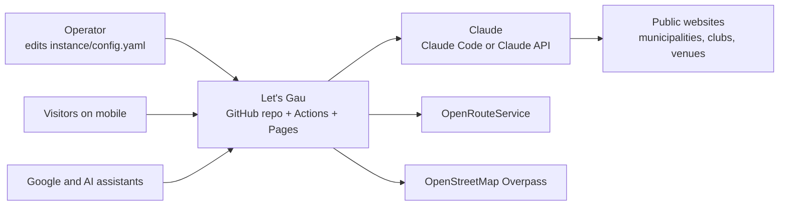
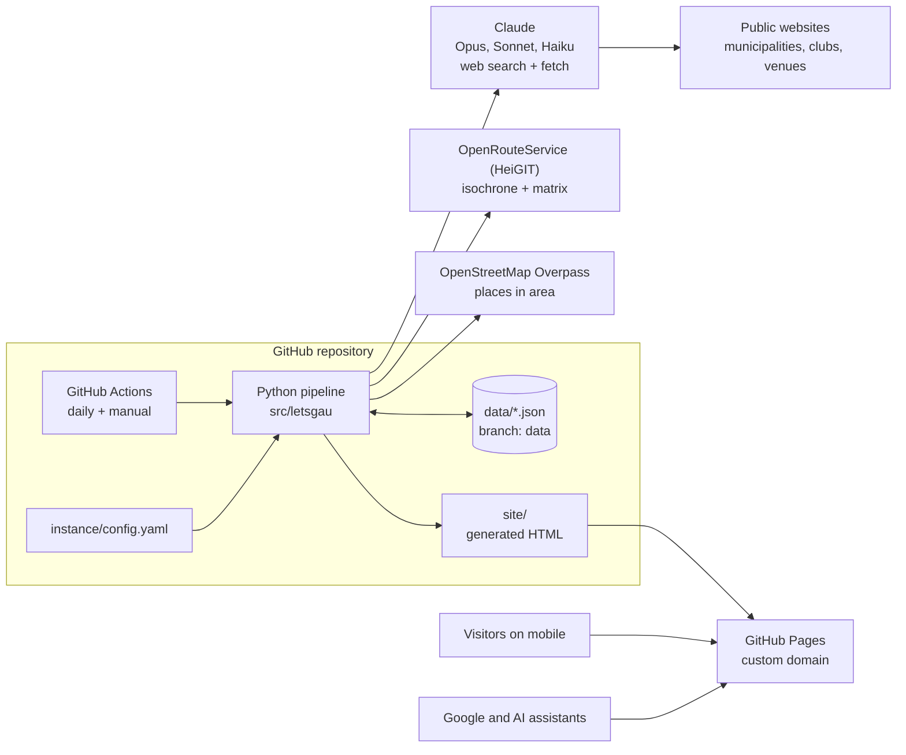
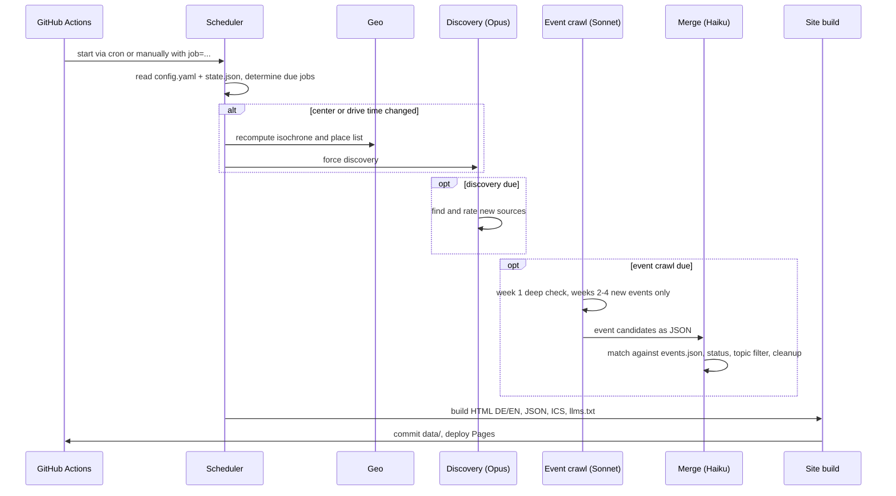
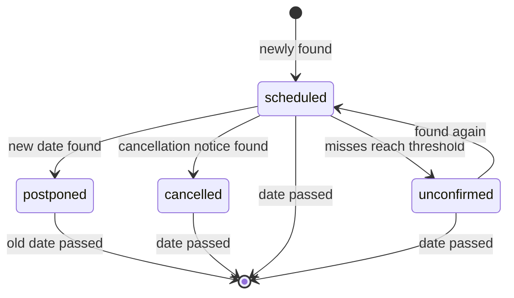

# Architecture

Everything lives in one GitHub repository. A workflow started daily runs a
Python pipeline that lets Claude search the web, stores the results as JSON on
the `data` branch and builds static HTML for GitHub Pages.

The authoritative specification is [CONCEPT.md](CONCEPT.md) (German).

## Context (C4 level 1)

## Containers (C4 level 2)

## Modules

| Module | Responsibility | Phase |
| --- | --- | --- |
| `config` | load and validate `config.yaml` | 0 |
| `cli` | command-line entry point | 0 |
| `scheduler` | decide which jobs are due, run them in order, job summary | 6 ✓ |
| `geo` | isochrone (ORS), places (Overpass), drive times (ORS matrix) | 1 ✓ |
| `ai_runner` | Claude Code headless (subscription) or Claude API (api_key) | 2 ✓ |
| `crawl` | event crawl per batch of places, validation | 2 ✓ |
| `models` | Pydantic models for `data/*.json` | 2–3 |
| `merge` | fuzzy dedupe, Haiku tie-break and topic check, status lifecycle, cleanup | 3 ✓ |
| `build`, `feeds` | HTML DE/EN, JSON-LD, JSON, ICS, llms.txt, sitemap, robots | 4–5 ✓ |
| `discovery` | find and rate sources, `sources.json`, suggestions, hit statistics | 7 ✓ |
| `init` | set up a fresh instance from `examples/instance/` | 8 ✓ |

## Sequence of a run

## Event status lifecycle

A cancelled event stays visible until its date. A postponement creates a new
event on the new date; `postponed_to` on the old event points to it.

## Key decisions

| Topic | Choice | Reason |
| --- | --- | --- |
| Hosting | GitHub Pages | free, custom domain, automatic HTTPS |
| Scheduling | workflow daily, frequencies in `config.yaml` | changing a frequency is one line, not cron syntax |
| Storage | JSON files on the `data` branch | free, versioned by Git; Supabase possible later |
| Pipeline | Python 3.12, Pydantic, Jinja2 | readable, good validation of AI output |
| AI | Claude Code headless (default) or Claude API with `web_search` / `web_fetch` | no own crawler needed |
| Models | Opus for discovery, Sonnet for events, Haiku for duplicates | thoroughness where it counts |
| Frontend | static HTML, one CSS, little vanilla JS | fast on mobile, readable for AIs without JS |
| Diagrams | Mermaid | renders on GitHub, maintainable as text |

ADRs live in [decisions/](decisions/).
