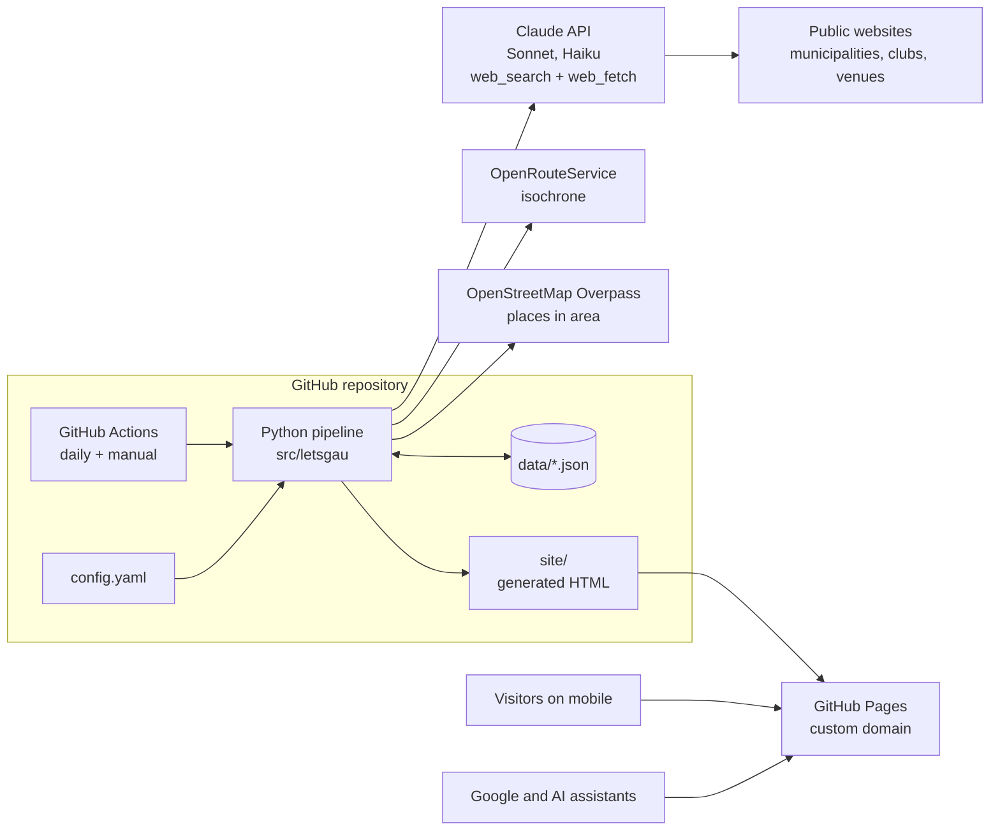
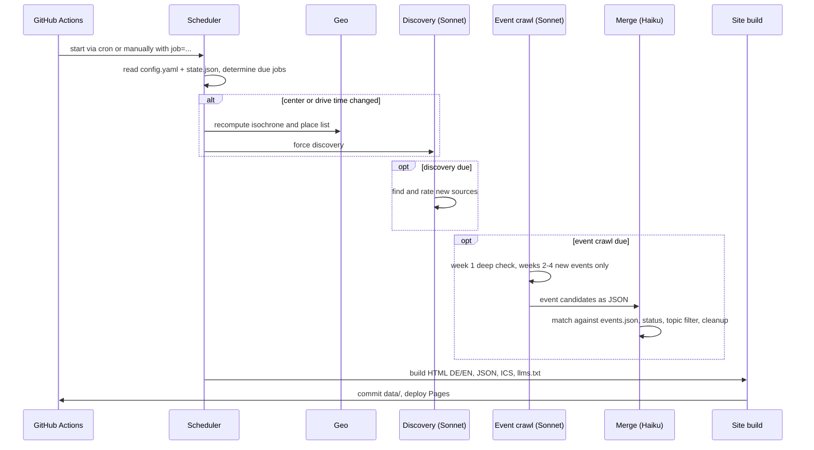
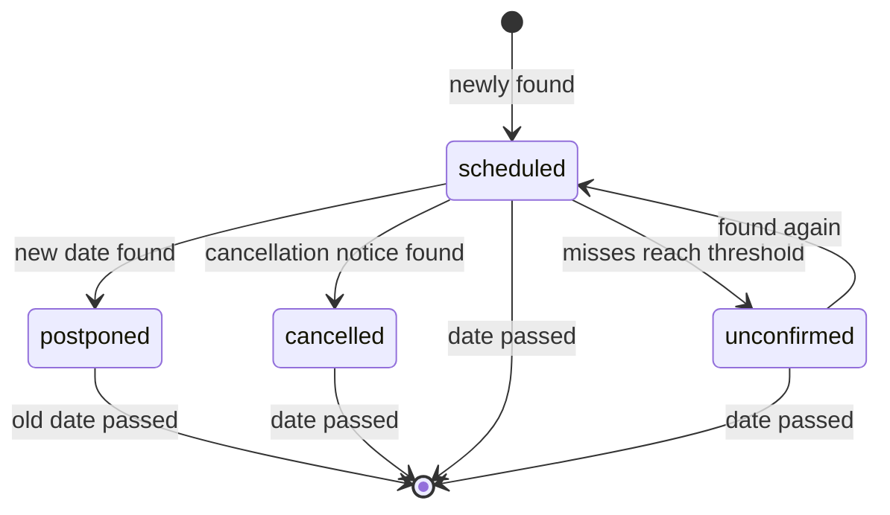

# Let's Gau – Konzept KI-Eventkalender

Nov 8, 2026 · @Matthias

## Überblick

Let's Gau ist ein Open-Source-Eventkalender. Eine KI sammelt zweimal pro Woche alle öffentlich auffindbaren Veranstaltungen im Umkreis von 30 Minuten Fahrzeit um einen konfigurierbaren Mittelpunkt (Standard: Schongau). Das Ergebnis ist eine statische, mobilfreundliche Website mit einer Ansicht pro Tag für die nächsten drei Wochen.

Dieses Dokument ist der Bauauftrag für Claude Code. Es beschreibt das Was und Warum so konkret, dass das Repository danach in Phasen umgesetzt werden kann (siehe Umsetzungsplan).

**Ziele**

- Möglichst vollständiger Überblick, auch über Kleines: Konzerte, Malabend im Café, Boxen, Eishockey, Märkte, Leonhardiritt.
- Pro Event nur Kerninfos: Titel, Ort, Datum, Uhrzeit, Kurzbeschreibung, Tags, Quelle.
- Gleich gut nutzbar für Menschen am Handy, für Google und für KI-Assistenten wie ChatGPT oder Claude.
- Für jede Region nutzbar: Mittelpunkt und Fahrzeit stehen in der Konfiguration, das Repo ist Open Source.
- Betrieb ohne eigenen Server und fast kostenlos: GitHub Actions, GitHub Pages, Claude API.
- Gründlich dokumentiert, für Menschen und für KI-Assistenten, mit Mermaid-Diagrammen.

**Nicht-Ziele für Version 1**

- Kein Auslesen von Facebook und Instagram (später eventuell über Apify).
- Keine Nutzerkonten und keine Eintragung durch Veranstalter; Quellen können nur per E-Mail vorgeschlagen werden.
- Nur Deutsch (Standard) und Englisch.
- Nur grobe Kategorien, keine Unter-Tags wie Eishockey.
- Kein Archiv vergangener Events.

## Architektur

Alles lebt in einem GitHub-Repository: Ein täglich gestarteter Workflow führt eine Python-Pipeline aus, die Claude per API suchen lässt, die Ergebnisse als JSON im Repo speichert und daraus statisches HTML für GitHub Pages baut. Die Diagramme hier sind Mermaid und können direkt in `docs/ARCHITECTURE.md` übernommen werden.

**Container-Sicht**



**Ablauf eines Laufs**



**Entscheidungen**

| Thema | Wahl | Grund |
| --- | --- | --- |
| Hosting | GitHub Pages | kostenlos, eigene Domain, automatisches HTTPS |
| Zeitsteuerung | Workflow täglich, Frequenzen in `config.yaml` | Frequenz ändern heißt eine Zeile ändern, nicht Cron-Syntax |
| Datenspeicher | JSON-Dateien in `data/` | kostenlos, über Git versioniert; später Umstieg auf Supabase möglich |
| Pipeline | Python 3.12, Pydantic, Jinja2 | einfach lesbar, gute Validierung der KI-Ausgabe |
| KI | Claude API mit den serverseitigen Tools `web_search` und `web_fetch` | kein eigener Crawler nötig; Blacklist lässt sich als `blocked_domains` übergeben |
| Modelle | Sonnet für Discovery und Events, Haiku für Duplikate | Sonnet reicht für die Suche nach Quellen und kostet einen Bruchteil von Opus; Haiku ist günstig beim Abgleich |
| Frontend | statisches HTML, ein CSS, wenig Vanilla-JS | schnell am Handy, lesbar für KIs ohne JavaScript |
| Diagramme | Mermaid | rendert direkt auf GitHub, als Text von KIs pflegbar |

Aktuelle Tool-Versionen, Modell-IDs und Preise vor der Umsetzung auf [docs.claude.com](https://docs.claude.com) prüfen.

**KI-Zugang: Abo oder API**

- Standard ist `ai.auth: subscription`. Die KI-Schritte Discovery, Event-Crawl und unklare Duplikate laufen dann über Claude Code im Headless-Modus, angemeldet mit `CLAUDE_CODE_OAUTH_TOKEN` aus Matthias' Claude-Abo. Claude Code nutzt seine eigenen Tools für Websuche und Seitenabruf, und das Modell wird je Schritt per `--model` gewählt.
- Claude Code schreibt seine Ergebnisse als JSON-Datei; die Pipeline validiert sie mit Pydantic. Die Blacklist steht im Prompt und wird danach noch einmal hart gefiltert.
- Mit dem Abo-Token darf nur Claude Code selbst laufen. Die Python-Pipeline ruft die Claude-API nie direkt mit diesem Token auf.
- Die Schritte ohne KI, also Geo, deterministischer Merge und Build, sind in beiden Modi gleich Python.
- Alternativ `ai.auth: api_key`: direkte Aufrufe der Claude-API mit `web_search` und `web_fetch`, Abrechnung nach Verbrauch. Das ist für Forks gedacht, die kein Abo haben, oder falls die Abo-Limits nicht reichen.
- Das Abo ist für den persönlichen Gebrauch gedacht. Für Matthias' eigene Seite passt das; jeder Fork nutzt sein eigenes Abo oder seinen eigenen API-Schlüssel.
- Die Läufe zählen gegen dieselben Nutzungslimits wie die normale Claude-Nutzung, deshalb die Crawls nachts laufen lassen. Die Job-Zusammenfassung zeigt die Dauer pro Lauf.

## Konfiguration

Alles, was ein Betreiber ändern will, steht in einer einzigen, Zeile für Zeile kommentierten `config.yaml`; Whitelist und Blacklist liegen als eigene Dateien daneben. Die Datei wird beim Start mit Pydantic validiert und bricht bei Fehlern mit einer verständlichen Meldung ab.

```yaml
site:
  name: "Let's Gau"
  base_url: "https://letsgau.de"        # domain not registered yet
  languages: [de, en]                   # first entry = default language
  owner: "<github-owner>"               # must match the repo owner, else build aborts
  contact_email: "hallo@letsgau.de"     # for source suggestions and feedback
  feedback_form_endpoint: ""            # form service URL; empty = mailto fallback

region:
  label: "Schongau"
  center: { lat: 47.811, lon: 10.896 }  # approx. Schongau old town
  drive_time_minutes: 30                # change triggers geo + discovery
  place_types: [city, town, village]    # OSM place types, hamlets ignored
  include_places: []                    # e.g. ["Landsberg am Lech", "Weilheim in Oberbayern"]
  exclude_places: []                    # places deliberately left out

window:
  display_days: 21                      # how far ahead the website shows
  crawl_days: 28                        # how far ahead we search (1 week buffer)
  deep_check_days: 7                    # period that gets thorough re-checks

jobs:                                   # format: off | daily | weekly:mon,thu | monthly:1
  discovery: "monthly:1"
  events: "weekly:mon,thu"
  build: "daily"                        # rebuild daily so "today" is correct

models:
  discovery: "claude-sonnet-5-5"
  events: "claude-sonnet-5-5"
  merge: "claude-haiku-5-5"

ai:
  auth: "subscription"                  # subscription (Claude Code + plan) | api_key (Claude API)

limits:
  max_web_searches_per_run: 150         # cost brake per run
  places_per_request: 6                 # places per Claude request
  max_runtime_minutes: 45

events:
  unconfirmed_after_misses: 2           # runs without a hit before "unconfirmed"
  description_max_chars: 200

sources:
  whitelist_file: "instance/sources/whitelist.yaml"
  blacklist_file: "instance/sources/blacklist.yaml"

excluded_topics:                        # topic blacklist: never include such events
  - "First-aid courses and similar mandatory courses"
  - "Events in strip clubs, swinger clubs and erotic events"
  - "Events by far-right parties and groups"

tags:                                   # fixed list, the AI must not invent new ones
  - { id: concert,         de: "Konzert",            en: "Concert" }
  - { id: party,           de: "Party",              en: "Party" }
  - { id: sports,          de: "Sport",              en: "Sports" }
  - { id: art-culture,     de: "Kunst & Kultur",     en: "Art & Culture" }
  - { id: theatre-cinema,  de: "Theater & Kino",     en: "Theatre & Cinema" }
  - { id: outdoor,         de: "Outdoor",            en: "Outdoor" }
  - { id: family-kids,     de: "Familie & Kinder",   en: "Family & Kids" }
  - { id: market-festival, de: "Markt & Fest",       en: "Market & Festival" }
  - { id: food-drink,      de: "Kulinarik",          en: "Food & Drink" }
  - { id: talk-workshop,   de: "Vortrag & Workshop", en: "Talk & Workshop" }
```

Whitelist und Blacklist sind einfache Listen:

```yaml
# sources/whitelist.yaml - always checked explicitly on every event run
- url: "https://www.schongau.de/veranstaltungen"
  note: "City of Schongau"

# sources/blacklist.yaml - never used as a source
- domain: "example-spam.de"
  reason: "outdated dates"
```

Die URLs sind Beispiele und müssen beim ersten Lauf geprüft werden.

## Datenmodell

Vier JSON-Dateien in `data/` bilden den gesamten Zustand; jedes Event wird genau einmal gespeichert, auch wenn es mehrere Tage dauert oder auf mehreren Seiten steht. Vergangene Events werden beim Merge gelöscht, die Git-Historie reicht als Nachweis.

| Datei | Inhalt |
| --- | --- |
| `data/places.json` | Orte im Gebiet mit Koordinaten und Fahrzeit, plus Fingerabdruck aus Mittelpunkt und Fahrzeit |
| `data/sources.json` | bekannte Quellen mit Herkunft, Status und Trefferstatistik |
| `data/events.json` | alle Events von gestern bis `crawl_days` in die Zukunft |
| `data/state.json` | letzter Lauf je Job, Geo-Fingerabdruck, Verbrauch des letzten Laufs |

**Event**

```json
{
  "id": "2026-11-28-weihnachtsmarkt-schongau",
  "parent_id": null,
  "title": { "de": "Schongauer Weihnachtsmarkt", "en": "Schongau Christmas Market" },
  "description": { "de": "Buden und Glühwein in der Altstadt.", "en": "Stalls and mulled wine in the old town." },
  "venue": { "name": "Marienplatz", "place": "Schongau", "address": null },
  "schedule": {
    "start_date": "2026-11-28", "end_date": "2026-12-23",
    "start_time": null, "end_time": null, "all_day": true,
    "dates": null,
    "opening_hours": [ { "days": "mon-fri", "from": "16:00", "to": "20:00" } ]
  },
  "primary_tag": "market-festival",
  "tags": ["market-festival", "food-drink"],
  "status": "scheduled",
  "postponed_to": null,
  "sources": [ { "url": "https://...", "primary": true, "first_seen": "2026-11-09", "last_seen": "2026-11-12" } ],
  "first_seen": "2026-11-09", "last_verified": "2026-11-12", "misses": 0
}
```

Das Beispiel ist erfunden und zeigt nur die Form.

| Feld | Regel |
| --- | --- |
| `id` | stabil: Startdatum + Slug aus Titel und Ort; ändert sich bei Merges nicht |
| `parent_id` | gesetzt bei Programmpunkten, z. B. Band auf dem Mittelaltermarkt; Ort wird vom Hauptevent geerbt |
| `title`, `description` | immer DE und EN; Eigennamen bleiben unverändert; Beschreibung höchstens 200 Zeichen, eigene Worte |
| `schedule.start_time` | `null`, wenn unbekannt; nie raten |
| `schedule.dates` | Liste einzelner Tage, wenn nicht durchgehend, z. B. nur Adventswochenenden |
| `schedule.opening_hours` | optional, je Wochentag; die Website zeigt die heutigen Zeiten |
| `primary_tag` | genau einer, bestimmt die Gruppierung nach Kategorie |
| `tags` | 1 bis 3 aus der festen Liste, enthält `primary_tag` |
| `status` | `scheduled`, `postponed`, `cancelled` oder `unconfirmed` |
| `sources` | alle Fundstellen; genau eine ist `primary`, bevorzugt die Seite des Veranstalters |
| `misses` | Läufe in Folge, in denen das Event in der Prüfwoche nicht mehr gefunden wurde |

**Status-Lebenszyklus**



Ein abgesagtes Event wird nicht gelöscht, sondern bleibt bis zum Termin sichtbar. Bei einer Verschiebung entsteht ein neues Event am neuen Datum, und `postponed_to` zeigt darauf.

**Quelle**

| Feld | Regel |
| --- | --- |
| `url`, `domain` | Einstiegsseite der Quelle |
| `kind` | `municipality`, `club`, `venue`, `calendar`, `press`, `other` |
| `places` | Orte, für die die Quelle relevant ist |
| `origin` | `whitelist`, `discovery` oder `crawl` (zufällig beim Event-Lauf gefunden) |
| `status` | `active` oder `blacklisted`; die Blacklist-Datei hat immer Vorrang |
| `hits`, `last_hit` | wie viele Events zuletzt von hier kamen; Grundlage für Whitelist-Vorschläge |

## Jobs und KI-Pipeline

Ein Workflow startet jeden Tag; das Skript entscheidet anhand von `config.yaml` und `state.json`, welche der fünf Stufen fällig sind, und beendet sich sonst nach Sekunden. Jede Stufe ist auch einzeln per CLI und per Button auf GitHub startbar.

**1. Scheduler**

- Cron im Workflow täglich früh, z. B. 04:00 UTC; zusätzlich `workflow_dispatch` mit Auswahl `auto`, `geo`, `discovery`, `events`, `build`, `all`. Der Button ist auch in der GitHub-App am Handy erreichbar.
- `concurrency`-Gruppe im Workflow, damit sich zwei Läufe nie überschneiden.
- Lokal: `python -m letsgau run --job events --dry-run --limit-places 3`.

**2. Geo (nur bei Änderung)**

- Fingerabdruck = Hash aus `center` und `drive_time_minutes`. Weicht er von `state.json` ab, wird neu berechnet und danach Discovery erzwungen.
- OpenRouteService-Isochrone (Profil Auto) ergibt die in X Minuten erreichbare Fläche, gespeichert als `geo/isochrone.geojson`.
- Overpass-Abfrage holt alle Orte der Typen aus `place_types` in dieser Fläche; danach `include_places` ergänzen und `exclude_places` entfernen.
- Pro Ort die Fahrzeit vom Mittelpunkt speichern (ORS Matrix); wird für "nach Entfernung" auf der Website genutzt.

**3. Discovery mit Sonnet (Standard monatlich)**

- Auftrag: Für jeden Ort gepflegte Veranstaltungsquellen finden, also Gemeindekalender, Vereine, Kulturzentren, Kinos, Cafés, Sporthallen, regionale Kalender und Presse.
- Jede Quelle bewerten: Gibt es aktuelle Termine? Mit Datum und Ort als Text? Wie oft aktualisiert?
- Neue Quellen landen mit `origin: discovery` in `sources.json` und werden ab sofort vom Event-Crawl genutzt.
- Zusätzlich schreibt der Job `sources/suggested.md`: Quellen mit vielen Treffern als Whitelist-Kandidaten, auffällige als Blacklist-Kandidaten. Übernehmen heißt eine Zeile in die jeweilige YAML kopieren.

**4. Event-Crawl mit Sonnet (Standard Montag und Donnerstag)**

- Orte werden in Pakete zu je `places_per_request` aufgeteilt, ein Claude-Aufruf pro Paket.
- Eingabe pro Aufruf: Orte, Zeitfenster, relevante Whitelist- und bekannte Quellen, Tag-Liste, die bereits bekannten Events dieser Orte in Kurzform, Blacklist als `blocked_domains` für die Websuche.
- Woche 1 (`deep_check_days`), gründlich: Quellseiten bekannter Events erneut abrufen und prüfen, ob Datum, Uhrzeit und Ort stimmen und ob "abgesagt" oder "verschoben" dasteht. Dazu freie Suchen pro Ort, etwa "Peiting Veranstaltungen dieses Wochenende".
- Wochen 2 bis 4: nur nach neuen Events suchen, bekannte nicht einzeln nachprüfen.
- Ausgabe: JSON nach festem Schema (Structured Outputs oder Tool-Aufruf mit Schema), danach Validierung mit Pydantic. Ungültige Einträge werden verworfen und geloggt.

Regeln im Prompt:

- Nur Events mit konkretem Datum und Ort im Gebiet; nichts erfinden, Uhrzeit `null` statt raten.
- Tags nur aus der Liste, genau ein `primary_tag`.
- Programmpunkte eines größeren Events (Band auf dem Mittelaltermarkt, Feuerschlucker, Kinderchor) als Kinder mit `parent_id` anlegen, nicht als eigene Events.
- Mehrtägiges einmal mit Start- und Enddatum, nicht pro Tag.
- Titel und Beschreibung gleich auf DE und EN; Beschreibung in eigenen Worten, keine Texte kopieren.
- Jede Fundstelle als Quelle angeben, Veranstalterseite als `primary` bevorzugen.

**Themen-Blacklist:** Die Einträge aus `excluded_topics` stehen als Freitext im Prompt; passende Events werden gar nicht erst ausgegeben. Zur Sicherheit prüft der Merge-Schritt jedes neue Event noch einmal mit Haiku gegen die Liste und verwirft Treffer mit Log-Eintrag. Anders als die Quellen-Blacklist wirkt das pro Event, unabhängig von der Webseite.

**5. Merge**

1. Deterministischer Abgleich: Datum überschneidet sich, gleicher Ort, ähnlicher normalisierter Titel. Eindeutige Treffer werden zusammengeführt und Quellen angehängt.
2. Unklare Paare entscheidet Haiku mit Ja oder Nein.
3. Status setzen: Absage oder Verschiebung aus dem Crawl übernehmen; in der Prüfwoche nicht gefundene Events erhöhen `misses`, ab dem Grenzwert `unconfirmed`.
4. Events mit Ende vor gestern löschen.

**6. Build und Deploy**

- Jinja2 erzeugt alle Seiten nach `site/` (siehe Website und KI-Lesbarkeit). Läuft täglich, damit "Heute" immer stimmt.
- Der Workflow committet `data/` und `sources/suggested.md` mit dem eingebauten `GITHUB_TOKEN` und veröffentlicht `site/` über die offizielle Pages-Action.
- Jeder Lauf schreibt eine Zusammenfassung in die GitHub-Job-Übersicht: neue, geänderte, abgesagte Events, Zahl der Suchen, Tokens und geschätzte Kosten.

Die Prompts liegen als eigene Dateien in `prompts/` und sind damit versioniert und ohne Code-Änderung anpassbar.

## Website

Die Website ist vom Handy aus gedacht: eine Seite pro Tag, kompakte Event-Zeilen, Details erst beim Antippen. So bleiben auch 100 Events an einem Samstag in etwa einer Minute überfliegbar.

**Adressen**

| Seite | Pfad |
| --- | --- |
| Startseite | `/` leitet auf gespeicherte Sprache, sonst `/de/` |
| Heute | `/de/` zeigt den heutigen Tag |
| Tag | `/de/2026-11-14/` und `/en/2026-11-14/` |
| Event | Anker auf der Tagesseite, z. B. `/de/2026-11-14/#2026-11-14-boxabend-peiting` |
| Inhaltsseiten | `/de/about/`, `/de/fehlt-mein-event/`, `/de/impressum/`, `/de/datenschutz/` |

Falls die gebaute Startseite älter als heute ist, springt ein kleines Skript auf den richtigen Tag.

**Aufbau einer Tagesseite**

```text
+------------------------------------+
| Let's Gau            Suche   DE|EN  |
| Bis 30 Fahrminuten um Schongau     |   Abdeckungs-Hinweis
| 21 Tage im Voraus                  |
| [Heute] [Morgen] [Wochenende]      |
| Do 12 | Fr 13 | Sa 14 | So 15 | >  |   Datumsleiste, wischbar
|  18   |  41   |  97   |  63   |    |   Anzahl Events
| (Konzert) (Sport) (Party) ...      |   Tag-Filter als Chips
| Gruppieren: Uhrzeit | Kategorie | Ort
+------------------------------------+
| > Ganztägig & mehrtägig (12)       |   standardmäßig zugeklappt
| NACHMITTAG                         |   klebt beim Scrollen
| 14:00  Kinderflohmarkt   Peiting   |
| 15:30  ERC - EV Füssen   Schongau  |
| ABEND                              |
| 19:00  Malabend          Café X    |
|        Malen mit Wein, ...         |   aufgeklappt
|        Quelle: cafe-x.de (+2)      |
| 20:00  Mittelaltermarkt  Altenstadt|
|        heute 5 Programmpunkte      |
+------------------------------------+
| Automatisch per KI gesammelt.      |
| Bitte vor dem Besuch prüfen.       |
+------------------------------------+
```

Die Einträge im Wireframe sind Platzhalter.

**Abdeckung sichtbar machen**

- Direkt unter dem Seitennamen steht gut lesbar, was die Seite abdeckt, z. B. "Bis 30 Fahrminuten um Schongau · 21 Tage im Voraus", auf Englisch "Within a 30-minute drive of Schongau · 21 days ahead".
- Der Satz wird beim Build aus `region.label`, `drive_time_minutes` und `display_days` erzeugt, steht also nie falsch und passt bei Forks automatisch.
- Derselbe Satz steht in `llms.txt`, in der `meta description` und auf der About-Seite.

**Navigation**

- Seite öffnet immer auf heute. Schnellknöpfe Heute, Morgen, Wochenende (springt zum nächsten Samstag).
- Datumsleiste waagerecht scrollbar, mit Wochentag, Datum und Anzahl Events; Wochenenden farbig hervorgehoben.
- Wischen nach links oder rechts auf der Liste wechselt den Tag; Pfeil-Links als Fallback ohne JavaScript.
- Kopfbereich klebt oben, schrumpft beim Runterscrollen auf eine Zeile und erscheint beim Hochscrollen wieder.

**Tagesliste**

- Abschnitte: Ganztägig & mehrtägig (zugeklappt, mit Anzahl), Vormittag (vor 12 Uhr), Nachmittag (12 bis 18 Uhr), Abend (ab 18 Uhr). Abschnittsüberschriften kleben beim Scrollen.
- Eine Zeile: Uhrzeit, Titel, Ort, kleine Tag-Symbole. Antippen klappt auf: Beschreibung, Adresse, Hauptquelle als Link plus "+2 weitere Quellen".
- Mehrtägiges zeigt "noch bis 23.12." und die heutigen Öffnungszeiten, falls bekannt.
- Hauptevents mit Programm: eine Zeile mit "heute 5 Programmpunkte", das Programm erscheint erst beim Aufklappen.
- Status: Abgesagt durchgestrichen mit rotem Hinweis; Verschoben mit Link zum neuen Tag; nicht mehr bestätigt grau markiert.

**Filter, Suche, Gruppierung**

- Tag-Chips mit drei Zuständen: neutral, einschließen, ausschließen. Mehrere einschließen = ODER; ausschließen gewinnt immer.
- Ein Programmpunkt erscheint einzeln nur, wenn ein Filter ihn trifft, das Hauptevent aber nicht; dann mit "im Rahmen von Mittelaltermarkt".
- Suchfeld filtert Titel, Ort und Beschreibung auf der Seite.
- Umschalter "Gruppieren nach": Uhrzeit (Standard), Kategorie nach `primary_tag`, Ort sortiert nach Fahrzeit.
- Filter, Gruppierung und Sprache werden im Browser gespeichert (localStorage mit try/catch) und bleiben beim Blättern erhalten.

**Technik und Sprache**

- Alle Events stehen fertig im HTML; JavaScript blendet nur ein und aus und lädt nichts nach. Ohne JavaScript ist alles sichtbar, nur ohne Filter.
- Ein CSS, ein JS ohne Framework (Ziel unter 10 KB), Systemschriften, keine externen CDNs oder Google Fonts.
- Umschalter DE|EN springt auf denselben Tag in der anderen Sprache. Feste Texte stehen in `i18n/de.yaml` und `i18n/en.yaml`, Event-Texte kommen zweisprachig aus der Pipeline.

## KI-Lesbarkeit und SEO

Eine KI oder Google soll ohne JavaScript alles verstehen, was ein Mensch sieht. Dafür gibt es sechs Bausteine, alle vom Build erzeugt.

| Baustein | Umsetzung |
| --- | --- |
| Fertiges HTML | alle Events im Markup, feste Adresse pro Tag und Sprache, Anker pro Event |
| schema.org `Event` | JSON-LD pro Event auf der Tagesseite mit `name`, `startDate`, `endDate`, `location`, `description`, `eventStatus` (Scheduled, Cancelled, Postponed); Programmpunkte über `superEvent` und `subEvent` |
| `llms.txt` | im Hauptverzeichnis: was die Seite ist, Region und Mittelpunkt, Aktualisierung, Tag-Liste, Adressmuster der Tagesseiten, Links auf JSON und ICS, Hinweis "KI-gesammelt, ohne Gewähr", Zeitpunkt der letzten Aktualisierung |
| Rohdaten | `/data/events.json` als öffentliche Kopie (ohne interne Felder wie `misses`) und `/data/events.ics` zum Abonnieren |
| Crawler-Zugang | `robots.txt` erlaubt alle, ausdrücklich auch GPTBot, ClaudeBot, PerplexityBot und Google-Extended; `sitemap.xml` mit allen Tagesseiten |
| Metadaten | `<title>` und `meta description` pro Tag ("Was ist los in und um Schongau am Samstag, 14. November"), `hreflang` DE/EN, `canonical`, Open-Graph-Tags für eine schöne Vorschau beim Teilen per WhatsApp |

Auf jeder Seite steht sichtbar "Zuletzt aktualisiert" mit Datum und Uhrzeit, damit Menschen und KIs die Aktualität einschätzen können.

## Inhaltsseiten und Rechtliches

Alle Inhaltsseiten sind Markdown-Dateien in `content/`, je eine pro Sprache, und werden mit demselben Layout gebaut. Für Forks sind es Vorlagen mit klar markierten Platzhaltern.

**About** (`content/about.de.md`, `about.en.md`): Matthias schreibt die Geschichte hinter der Seite selbst. Vorlage mit Platzhaltern für Idee, Motivation und Kontakt.

**Warum ist mein Event nicht hier?** (`content/missing-event.*.md`), geschrieben für Café-Betreiber und Vereine, ohne Technik-Kauderwelsch:

1. Die Seite sammelt automatisch von öffentlichen Webseiten, aber nicht von Facebook und Instagram.
2. Event auf die eigene Webseite oder in einen öffentlichen Kalender stellen, etwa den der Gemeinde, mit Datum, Uhrzeit und Ort als Text und nicht nur als Bild.
3. Möglichst früh veröffentlichen, mindestens eine Woche vorher.
4. Fehlt es trotzdem: Webseite per E-Mail an `contact_email` vorschlagen. Nach Prüfung kommt sie auf die Whitelist und wird bei jedem Lauf abgefragt.

**Feedback** (`/de/feedback/`, `/en/feedback/`): ein Formular für drei Anliegen, nämlich Event oder Quelle fehlt, Fehler melden und Feature-Wunsch.

- Felder: Art (Auswahl), Nachricht, optional E-Mail für Rückfragen, unsichtbares Honeypot-Feld gegen Spam.
- Die statische Seite hat kein Backend, deshalb geht das Formular an einen Formular-Dienst; dessen Adresse steht in `site.feedback_form_endpoint`. Einen Dienst mit EU-Hosting wählen und in der Datenschutzerklärung nennen.
- Ist kein Endpoint gesetzt, zeigt die Seite stattdessen einen `mailto:`-Link mit vorausgefülltem Betreff je Anliegen.
- Daneben Links zu den GitHub-Issue-Formularen für alle mit GitHub-Konto.
- Link im Footer jeder Seite und auf "Warum ist mein Event nicht hier?".

**Changelog** (`/changelog/`): Der Build erzeugt die Seite aus `CHANGELOG.md` der Engine, Link im Footer. Der Text bleibt auf beiden Sprachversionen Englisch, weil er aus dem Repo kommt; darüber steht ein kurzer Satz in der jeweiligen Sprache.

**Hinweis zur KI** auf jeder Tagesseite unten und auf der About-Seite: Events werden automatisch per KI gesammelt und können falsch oder veraltet sein. Bitte vor dem Besuch kurz beim Veranstalter oder per Websuche prüfen.

**Rechtliches** (kein Rechtsrat, vor dem Livegang prüfen lassen):

- Impressum mit Anbieterangaben nach Digitale-Dienste-Gesetz.
- Datenschutzerklärung: GitHub Pages verarbeitet beim Aufruf IP-Adressen; keine Cookies, kein Tracking, keine externen Schriften oder CDNs; localStorage nur für Filter und Sprache.
- Urheberrecht: nur eigene Kurzbeschreibungen, keine kopierten Texte oder Bilder aus den Quellen; die Quelle wird verlinkt.

## Repository, Dokumentation, Secrets, Kosten

Das Repo trennt sichtbar Konfiguration, Inhalte, Daten, Code und generierte Ausgabe, damit Mensch und KI sofort sehen, was wohin gehört.

**Sprache:** Alles Technische ist Englisch: Code, Kommentare, Docstrings, Commit-Messages, Pull Requests, Issues, Prompts, Konfigurationsschlüssel und -kommentare, Tag-IDs, Dateinamen, Log-Ausgaben und die gesamte Repo-Doku (`README.md`, `CLAUDE.md`, `docs/`). Deutsch gibt es nur in Website-Inhalten, also `i18n/de.yaml` und `content/*.de.md`. Dieses Konzept ist auf Deutsch geschrieben; Claude Code überträgt beim Umsetzen alles Technische ins Englische.

**Ein Repo, Instanz im eigenen Ordner**, damit Forks Matthias' Konfiguration, Daten und Impressum nicht übernehmen:

- Ein öffentliches Repo `letsgau` (MIT). Code, Templates, Prompts und Doku liegen wie üblich im Hauptverzeichnis; alles Schongau-Spezifische liegt unter `instance/`, also `config.yaml`, `sources/` und `content/`.
- Generierte Daten (`data/`, `geo/`) committet der Bot auf einen eigenen Branch `data`, nie auf `main`. So bleibt die Historie von `main` sauber, und ein Fork kopiert die Daten standardmäßig nicht mit, weil GitHub nur `main` übernimmt.
- `letsgau init` fragt Mittelpunkt, Fahrzeit, Name, Domain, Kontakt und Owner ab und überschreibt `instance/` mit frischen Dateien aus `examples/instance/`.
- Schutz im Build: Er bricht ab, wenn noch Platzhalter drinstehen oder `site.owner` nicht zum GitHub-Owner des Repos passt (`GITHUB_REPOSITORY_OWNER`). Eine kopierte Config mit fremder Domain und fremdem Impressum geht so nie live.
- Das Repo liegt unter Matthias' persönlichem GitHub-Account. Ein Umzug in eine Organisation ist später jederzeit möglich, GitHub leitet alte Links weiter.
- Eine Aufteilung in Engine- und Instanz-Repo erst, wenn andere das Projekt ernsthaft nutzen.

```text
letsgau/                  branch main (public, MIT)
  README.md               what it is, how to set up your own region
  CLAUDE.md               guide for AI assistants
  CHANGELOG.md            Keep a Changelog, SemVer
  .env.example            template for local secrets
  docs/
    ARCHITECTURE.md       Mermaid: context, container, sequence, state
    DATA_MODEL.md         fields and rules
    CONFIGURATION.md      every option explained
    OPERATIONS.md         run jobs, debug, check costs
    decisions/            short ADRs (ADR-001, ...)
  prompts/                discovery.md, events.md, merge.md
  instance/               Matthias' Schongau instance
    config.yaml           Schongau, 30 min, letsgau.de, owner
    sources/              whitelist.yaml, blacklist.yaml, suggested.md
    content/              about, missing-event, feedback, imprint, privacy (DE/EN)
  examples/instance/      templates for `letsgau init` (placeholders)
  i18n/                   de.yaml, en.yaml
  src/letsgau/            cli, init, scheduler, config, models, geo, discovery,
                          crawl, merge, ai_runner, build
  templates/              Jinja2: base, day, page, changelog, feedback, partials
  static/                 style.css, app.js, icons
  tests/                  recorded AI responses, no AI calls
  .github/
    workflows/            ci.yml, run.yml
    ISSUE_TEMPLATE/       bug, feature request, source suggestion
  site/                   generated, in .gitignore

branch data (bot only)
  data/                   places.json, sources.json, events.json, state.json
  geo/                    isochrone.geojson
```

**Dokumentation**

- `README.md` für Menschen: was das Projekt macht, Screenshot, Einrichtung in fünf Schritten (Fork, Secrets, `config.yaml`, Pages aktivieren, ersten Lauf starten), manueller Start, Domain verbinden.
- `docs/ARCHITECTURE.md` mit den Mermaid-Diagrammen aus diesem Konzept, als C4-Kontext, Container, Sequenz und Status-Diagramm.
- `CLAUDE.md` für KI-Assistenten: Dateikarte, wichtige Befehle, Konventionen, Verbote. Verbote: nie Secrets committen, `site/` nie von Hand ändern, Schemaänderungen nur mit Migration der JSON-Dateien, Prompt-Änderungen mit Testlauf `--dry-run`.
- Docstrings in jedem Modul und jede Option in `config.yaml` kommentiert.

**Secrets**

- In GitHub unter Settings, Secrets: `ANTHROPIC_API_KEY` und `ORS_API_KEY`. Werden verschlüsselt gespeichert, in Logs geschwärzt und beim Forken nicht mitkopiert.
- Commits und Deploy laufen über den eingebauten `GITHUB_TOKEN` mit den Rechten `contents: write`, `pages: write`, `id-token: write`.
- Lokal: `.env` (in `.gitignore`) nach Vorlage `.env.example`.
- In der Anthropic Console ein monatliches Ausgabelimit setzen.

Im Abo-Modus ersetzt `CLAUDE_CODE_OAUTH_TOKEN` den `ANTHROPIC_API_KEY`; der Token wird lokal mit `claude setup-token` erzeugt.

**Kosten** (grobe Erwartung, nach den ersten Läufen messen)

| Posten | Erwartung |
| --- | --- |
| Claude API | Im Abo-Modus keine Zusatzkosten, zählt aber gegen die Nutzungslimits des Abos. Im API-Modus vermutlich einstellig bis niedrig zweistellig in Euro pro Monat, Websuchen werden zusätzlich pro Suche abgerechnet |
| GitHub Actions und Pages | für öffentliche Repos kostenlos |
| OpenRouteService | kostenloser Schlüssel reicht, Abfragen nur bei Gebietsänderung |
| Domain | wenige Euro pro Jahr |

Die Job-Zusammenfassung jedes Laufs zeigt Tokens, Suchen und geschätzte Kosten, damit die Schätzung schnell durch echte Zahlen ersetzt wird.

## Umsetzungsplan

Claude Code baut in neun Phasen, jede als eigener Pull Request mit Tests und aktualisierter Doku. Eine Phase gilt als fertig, wenn alle ihre Kriterien erfüllt sind.

**Phase 0: Gerüst**

- [ ] Repo-Struktur wie oben, `pyproject.toml`, Ruff, Pytest, `ci.yml` läuft grün
- [ ] `config.yaml` wird mit Pydantic geladen; ein Tippfehler ergibt eine klare Meldung mit Zeile und Feld
- [ ] `python -m letsgau --help` listet alle Befehle; `README.md`, `CLAUDE.md` und `docs/ARCHITECTURE.md` als erste Fassung

**Phase 1: Geo**

- [ ] Für Schongau und 30 Minuten entsteht eine plausible Ortsliste mit Fahrzeiten in `data/places.json`
- [ ] Ändern von Fahrzeit oder Mittelpunkt löst Neuberechnung aus, ein zweiter Lauf ohne Änderung nicht
- [ ] `include_places` und `exclude_places` wirken, z. B. Landsberg und Weilheim

**Phase 2: Event-Crawl**

- [ ] Ein Lauf liefert Events für 28 Tage, alle bestehen die Schema-Validierung
- [ ] Keine Quelle stammt von einer Blacklist-Domain; jede Whitelist-Quelle wurde abgefragt
- [ ] Jedes Event hat DE- und EN-Texte, Tags nur aus der Liste, genau einen `primary_tag`
- [ ] `--dry-run` und `--limit-places` funktionieren

**Phase 3: Merge und Status**

- [ ] Zwei Läufe hintereinander erzeugen keine Duplikate, Quellen werden angehängt
- [ ] Test-Fixtures für Absage, Verschiebung, verschwundenes Event und Programmpunkte ergeben den richtigen Status bzw. `parent_id`
- [ ] Mehrtägiges steht einmal in `events.json`; Vergangenes wird gelöscht

**Phase 4: Website**

- [ ] Tagesseiten DE und EN für 21 Tage mit Abdeckungs-Hinweis, Datumsleiste, Abschnitten, Aufklappen, Programmpunkten und Status-Darstellung
- [ ] Filter mit Ein- und Ausschluss, Suche, Gruppierung, Wischen; Einstellungen bleiben beim Blättern erhalten
- [ ] Ein Fixture-Tag mit 100 Events ist auf einem 375 px breiten Bildschirm übersichtlich
- [ ] Ohne JavaScript sind alle Events sichtbar; Lighthouse mobil mindestens 90 in Performance und Barrierefreiheit

**Phase 5: KI-Lesbarkeit**

- [ ] JSON-LD besteht den schema.org-Validator ohne Fehler
- [ ] `llms.txt`, `events.json`, `events.ics`, `sitemap.xml`, `robots.txt` werden erzeugt
- [ ] Abruf einer Tagesseite mit `curl` zeigt alle Events im Text

**Phase 6: Scheduler und Workflow**

- [ ] Täglicher Lauf führt nur fällige Jobs aus; Frequenzänderung in `config.yaml` wird beim nächsten Lauf beachtet
- [ ] Button "Run workflow" mit Job-Auswahl funktioniert
- [ ] Daten werden committet, Pages wird deployt, Job-Zusammenfassung zeigt Änderungen und Kosten

**Phase 7: Discovery**

- [ ] Discovery-Lauf (Sonnet) ergänzt `sources.json` und schreibt `sources/suggested.md` mit bewerteten Kandidaten
- [ ] Wird nach Geo-Änderung automatisch ausgelöst

**Phase 8: Inhalte, Domain, Abschluss**

- [ ] About, "Warum ist mein Event nicht hier?", Impressum, Datenschutz als Vorlagen DE und EN
- [ ] Eigene Domain in `README.md` beschrieben, `CNAME` wird aus `base_url` erzeugt
- [ ] Ein frischer Fork mit anderem Mittelpunkt, z. B. Murnau, läuft nach letsgau init nur mit den README-Schritten durch und enthält keine Schongau-Daten

## Projektorganisation in GitHub

Aufgaben, Fehler, Wünsche und Änderungen werden komplett in GitHub geführt, damit Code und To-dos an einem Ort liegen und Claude Code direkt damit arbeiten kann.

- **Issues und Milestones:** Phase 0 legt pro Phase einen Milestone an und pro Abnahmekriterium ein Issue. Backlog-Ideen werden Issues mit Label `backlog`.
- **Project-Board** (GitHub Projects) mit den Spalten Todo, In progress, Done. Ein Pull Request mit `Closes #12` schließt das Issue und verschiebt es automatisch.
- **Labels:** `phase-0` bis `phase-8`, `bug`, `feature-request`, `source-suggestion`, `backlog`, `crawler-report`.
- **Issue-Formulare** in `.github/ISSUE_TEMPLATE/` für Bug, Feature-Wunsch und Quellen-Vorschlag; dieselben Kategorien wie im Feedback-Formular.
- **Changelog:** `CHANGELOG.md` nach Keep a Changelog, Versionen nach SemVer, Commits nach Conventional Commits. Jeder Pull Request ergänzt den Abschnitt `Unreleased`.
- **Releases:** Jede abgeschlossene Phase wird ein Release mit Tag (`v0.1.0`, `v0.2.0`, ...). Forks können gezielt auf einen solchen Tag aktualisieren.

## Backlog

Ideen für nach Version 1, nicht Teil der Phasen.

- [ ] **Crawler-Bericht als GitHub Issue:** Jeder Lauf öffnet ein Issue "Crawler report YYYY-MM-DD" mit Label `crawler-report`. Inhalt: neue, geänderte und abgesagte Events; fehlgeschlagene Abrufe; verworfene Einträge mit Grund (Schema, Themen-Blacklist); neue Quellen als Whitelist- und Blacklist-Kandidaten zum Abhaken; Suchen, Tokens und geschätzte Kosten. Der Bericht des Vorlaufs wird automatisch geschlossen, Benachrichtigung kommt über die GitHub-App. Braucht im Workflow zusätzlich `issues: write` und löst langfristig `sources/suggested.md` ab.

## Offene Punkte

Diese Punkte sollte Matthias vor oder während Phase 0 entscheiden; für jeden gibt es einen Vorschlag, mit dem Claude Code sonst startet.

| Frage | Vorschlag |
| --- | --- |
| Ist `letsgau.de` frei, bleibt der Name? | bei DENIC prüfen; bis dahin Arbeitsname Let's Gau |
| Sprache von Code und Repo-Doku | entschieden: Englisch, siehe Abschnitt Repository |
| Repo öffentlich oder privat? | öffentlich: Actions und Pages kostenlos; Pages für private Repos braucht einen bezahlten GitHub-Plan |
| Lizenz | MIT |
| Landsberg und Weilheim standardmäßig drin? | erst ohne starten, nach dem ersten Lauf entscheiden |
| Kontakt-E-Mail für Quellen-Vorschläge | eigene Adresse auf der Domain |
| Angaben für Impressum | von Matthias einzutragen |
| Kostenlimit pro Lauf und pro Monat | 150 Suchen pro Lauf, Monatslimit in der Console nach den ersten Läufen festlegen |
| Facebook und Instagram | später prüfen, etwa über Apify mit fester Account-Liste |
